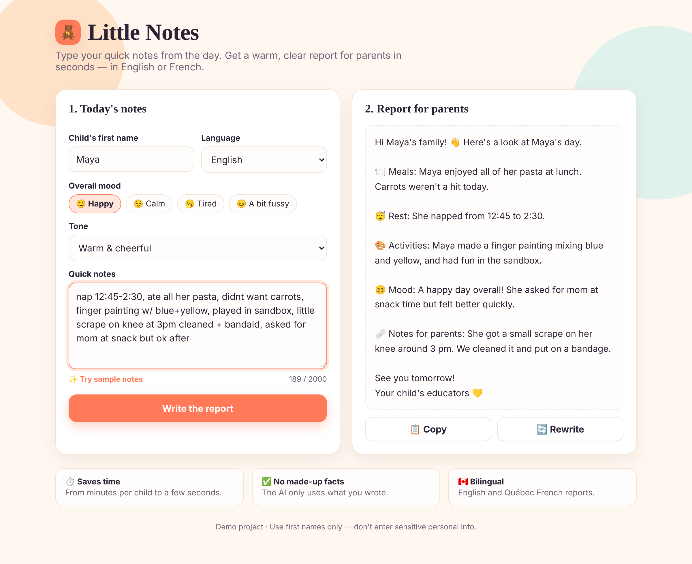

# 🧸 Little Notes — AI Daily Reports for Daycares

**Turn quick educator notes into warm, clear daily reports for parents in seconds.**

Educators write "nap 1–2:30, ate lunch, painted" all day long. Turning those scribbles into a proper message for every parent takes 2–5 minutes per child. With a group of 8–10 kids, that's more than 30 minutes a day.

Little Notes does it in about 3 seconds per child, in **English or Québec French**.

🔗 **Live demo:** _add your Vercel link here_



---

## ✨ Features

- **Notes → report in one click:** messy shorthand becomes a friendly, well-organized message
- **No made-up facts:** the AI is instructed to use only what the educator wrote
- **Incidents handled carefully:** scrapes or concerns are reported calmly and clearly, never hidden
- **Bilingual:** English 🇬🇧 and Québec French 🇨🇦
- **Tone control:** warm, short, or professional
- **Copy and rewrite** buttons for fast daily use
- **API key stays private:** AI calls go through a server function, never the browser

## 🛠️ Tech stack

| Part | Tool |
|---|---|
| Front end | HTML, CSS, vanilla JavaScript (no framework) |
| Back end | Vercel serverless function (Node.js) |
| AI | Google Gemini API (`gemini-3.8-flash`) |
| Hosting | Vercel (free tier) |

## 📁 Project structure

```
├── index.html          # The whole interface
├── api/generate.js     # Serverless function that calls the AI
├── docs/screenshot.png
└── .env.example        # Environment variables you need
```

## 🚀 Run it yourself

1. Get a free Gemini API key at [Google AI Studio](https://aistudio.google.com/apikey).
2. Fork this repo and import it into [Vercel](https://vercel.com/new).
3. In Vercel → Settings → Environment Variables, add `GEMINI_API_KEY`.
4. Deploy.

Local development: `npx vercel dev` (with a `.env` file based on `.env.example`).

## 🧠 How the AI prompt works

The prompt in `api/generate.js` tells the model to:
1. Use only facts from the notes, never invent anything
2. Group information into Meals, Rest, Activities, Mood, and Notes for parents, skipping empty sections
3. Report incidents clearly without minimizing them
4. Stay between 60 and 150 words in the chosen language and tone

## 🔒 Privacy note

This is a demo. Use first names only and don't enter sensitive information. A production version would add login, per-daycare accounts, and a paid AI tier where data isn't used for training.

## 🗺️ Next ideas

- Save each child's profile (allergies, routine) to personalize reports
- Send reports to parents directly by email or SMS
- Voice-to-text for hands-free note taking

---

Built by **Aicha Ben Khadda**. Want a tool like this for your business? [Connect on LinkedIn](#)
